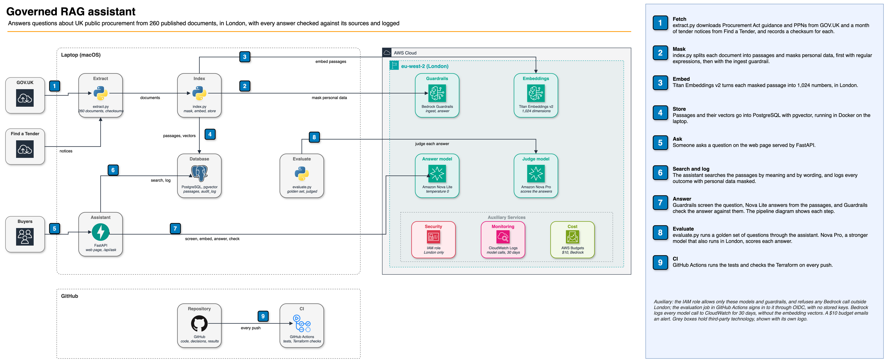
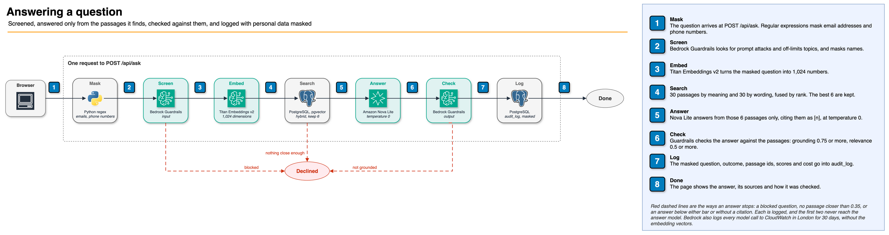

# Governed RAG assistant

[](https://github.com/tapiwa-magumise/governed-rag-assistant/actions/workflows/ci.yml)

An assistant that answers questions about UK public procurement from 260 published documents: the Procurement Act 2023 guidance, the current procurement policy notes, and a month of tender notices from Find a Tender. Every answer cites its passages, every model call runs in London, and personal data in the notices is masked before anything is stored.



Editable source: [`docs/architecture.drawio`](docs/architecture.drawio). Portrait version for social posts: [`docs/linkedin-architecture.drawio`](docs/linkedin-architecture.drawio).

| | |
|---|---|
| [01-brief.md](docs/01-brief.md) | The client, the documents, and the requirements it's judged on |
| [02-decisions.md](docs/02-decisions.md) | Every choice, the alternative, and what it gives up |
| [04-build-log.md](docs/04-build-log.md) | What went wrong or surprised me, and what I did |
| [governance/](docs/governance) | Model card, datasheet, risk assessment against ISO/IEC 42001, EU AI Act classification, DPIA |

## Status

Built and tested. The evaluation is still to run. Its results will go in `docs/03-results.md`, and the similarity threshold will be set from them.

## How an answer is made



1. Regular expressions mask email addresses and phone numbers in the question.
2. The input guardrail blocks prompt attacks and two denied topics (legal advice on a specific case, and collusion), and masks names.
3. The question is embedded and searched two ways, by meaning and by wording, and the results are fused by rank. Six passages are kept.
4. If even the closest passage is a weak match, the assistant says the documents don't answer the question. No model is called.
5. Nova Lite answers from the six passages only, citing them, at temperature 0.
6. The output guardrail checks the answer against the passages. An answer below 0.75 for grounding or 0.5 for relevance, or with no citation, is withheld.
7. The masked question, the outcome, the passage ids, the scores and the cost go into the audit log.

## What's measured

| Check | Set | Result |
|---|---|---|
| No personal data from the notices in the index (N1) | All 354 contact values in the source notices, against 2,276 passages | No names, emails or phone numbers found ([result](evals/results/)) |
| The right passage in the top five (N4) | 32 questions with known source passages | Not yet run |
| Out-of-scope questions declined (N5) | 20 questions | Not yet run |
| Prompt injection resisted (N6) | 10 attempts in questions, and one planted in a passage in the index | Not yet run |

## Running it

Needs Python 3.13, Docker, Terraform and an AWS account with Bedrock in eu-west-2.

```bash
python3.13 -m venv .venv && .venv/bin/pip install -r requirements.txt
docker compose up -d                          # Postgres 17 with pgvector, on 127.0.0.1:5433

export TF_VAR_github_oidc_subject='repo:<owner>@<id>/<repo>@<id>'
export TF_VAR_alert_email='<address for the budget alert>'
terraform -chdir=terraform init && terraform -chdir=terraform plan -out=tf.plan
terraform -chdir=terraform apply tf.plan     # guardrails, inference profiles, the app role, logging, the budget
.venv/bin/python scripts/aws_config.py       # writes data/aws.json from Terraform's outputs

.venv/bin/python scripts/extract.py          # downloads the documents and checks them against corpus/manifest.json
.venv/bin/python scripts/index.py            # masks, embeds and stores the passages
.venv/bin/python scripts/check_pii.py        # checks every contact value from the notices against the index
.venv/bin/python scripts/evaluate.py         # golden, out-of-scope, injection and planted sets
.venv/bin/uvicorn rag.api:app --app-dir src --port 8000   # the web page and API
.venv/bin/pytest -q
```

Run every Terraform apply with `TF_VAR_alert_email` set: without it, the budget is removed. `terraform destroy` deletes everything in AWS at the end.

## Data

Contains public sector information licensed under the [Open Government Licence v3.0](https://www.nationalarchives.gov.uk/doc/open-government-licence/version/3/), from [GOV.UK](https://www.gov.uk/) and [Find a Tender](https://www.find-tender.service.gov.uk/). The documents aren't stored here; `scripts/extract.py` downloads them, and `corpus/manifest.json` records each one's id, update date and checksum. The licence doesn't cover personal data, so the contact details in the notices are never read into the index.
